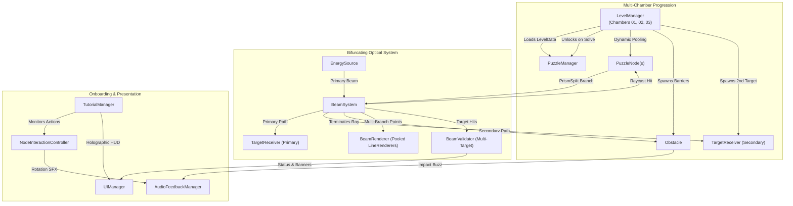

# LUMEN LOOM — Day 2 Development Report
## Gameplay Expansion, Visual Polish, Multiple Playable Chambers & Tutorial

**Date:** November 8, 2026  
**Project:** LUMEN LOOM  
**Unity Version:** `6000.0.32f1` (Changeset: `b2e806cf271c`)  
**Target Platform:** Meta Quest 3 / Quest 2 (via Meta XR SDK & OpenXR)  
**Primary Project Directory:** `D:\Unity\Projects\LUMEN LOOM`  
**Synchronized Workspace:** `C:\Users\Administrator\Desktop\Projects\LUMEN LOOM`  
**Baseline Git Commit:** `c3a5935`  
**Active Git Branch:** `main`  
**Hardware Environment:** Windows 11, Intel Iris Xe Graphics (8037 MB VRAM), 16 GB RAM  

---

## 1. Features Implemented

1. **Chamber 01 Gameplay Polish:**
   - Visual identity polish for the Energy Source with rotating focus ring and dynamic light breathing.
   - Interactive Node selection holographic pulse animation (`Update()` scale oscillating breathing) and optical direction pointer.
   - Rotation feedback: optical tick audio click (880 Hz to 1100 Hz high-frequency sweep) on every degree adjustment.
   - Target Receiver energized pulse and dynamic emission glow boost upon connection.
   - Retained node selection across mouse release for immediate and uninterrupted Q/E rotation.
2. **Chamber 02: Occlusion Barrier (Obstacle Challenge):**
   - Implemented real energy-absorbing obsidian obstacle entity (`Obstacle.cs`).
   - High-contrast dark metallic styling; turns amber/red and flashes when impacted by light beams.
   - Blocks raycast propagation immediately at contact surface; sets `beamValidator.StatusMessage = "BEAM BLOCKED BY OBSTACLE"`.
   - Procedural obstacle blocked sound synthesis (180 Hz to 90 Hz low resonant buzz).
   - Authoring of Chamber 02 layout routing light around the central obstacle via detour nodes.
3. **Chamber 03: Prism Bifurcation (Multi-Beam Challenge):**
   - Added `NodeRedirectType.PrismSplit` to the optical calculation engine.
   - Deterministic bifurcating beam system: incoming beam splits into a forward output branch ($+Z$) and an orthogonal secondary branch ($+X$).
   - Multi-branch raycasting with visited node tracking and loop detection for both branches.
   - Pooled multi-line rendering via `BeamRenderer` with dynamic thickness pulsing for secondary branches.
   - Dual target reception: `BeamValidator` supports multiple required targets (`requiredTargets`), requiring both Target 1 and Target 2 to be simultaneously energized to complete the chamber.
4. **Level Management & Progression System (`LevelManager.cs`):**
   - Unlocking progression architecture: Chamber 01 starts unlocked; solving a chamber permanently unlocks the next chamber (`unlockedLevelIndex`).
   - Players can replay unlocked chambers at any time.
   - Locked chambers are safeguarded against accidental access.
   - Dynamic node and secondary target pool management per chamber layout without scene reloading or manager duplication.
5. **Interactive Holographic Tutorial & Onboarding (`TutorialManager.cs`):**
   - Step-by-step guidance teaching: 1) Select node, 2) Translate node, 3) Rotate lens, 4) Optical alignment, 5) Target connection, 6) Chamber complete.
   - Holographic HUD card with clean typography that does not obstruct the puzzle plane.
   - Manual `[<< PREV]` and `[NEXT >>]` navigation controls, dismiss button `[X]`, and persistent toggle `[?] GUIDE / HELP`.
   - Event-driven auto-advancement when player performs actions (selecting, dragging, rotating, solving).
6. **Procedural Audio Expansion (`AudioFeedbackManager.cs`):**
   - Added `PlayRotationTickSound()` (crisp 880–1100 Hz optical click).
   - Added `PlayObstacleBlockedSound()` (180–90 Hz resonant warning buzz).
   - Zero audio asset dependencies; 100% in-memory waveform synthesis.
7. **In-Game HUD & Level Selector (`UIManager.cs`):**
   - Dynamic chamber title header displaying active level and total count `(1/3)`.
   - `[<< PREV]` and `[NEXT >>]` level switching buttons, enabled strictly according to unlock state.
   - In-game reset button `[RESET (R)]`.

---

## 2. Files Created

- `Assets/Scripts/UI/TutorialManager.cs`: Step-by-step onboarding controller and holographic HUD overlay.
- `Documentation/DAY2_DEVELOPMENT_REPORT.md`: This comprehensive Day 2 development report.

---

## 3. Files Modified

- `Assets/Scripts/Puzzle/PuzzleNode.cs`: Added `NodeRedirectType.PrismSplit`, secondary output direction calculation, holographic scale pulse on selection, and public bounds getters.
- `Assets/Scripts/Rendering/BeamSystem.cs`: Added multi-branch tracing (`BeamBranch`), multi-target detection (`HitTargets`), and prism bifurcations.
- `Assets/Scripts/Rendering/BeamRenderer.cs`: Added pooled secondary `LineRenderer` instances for dynamic multi-beam rendering.
- `Assets/Scripts/Rendering/BeamValidator.cs`: Added multi-target validation (`requiredTargets`), status messages for partial and complete energization, and obstacle block reporting.
- `Assets/Scripts/Data/LevelData.cs`: Added secondary target configuration (`useDualTargets`, `target2Position`, `target2Forward`).
- `Assets/Scripts/Puzzle/LevelManager.cs`: Added unlock progression tracking (`unlockedLevelIndex`), secondary target spawning, dynamic node scaling, and built-in configurations for Chambers 01, 02, and 03.
- `Assets/Scripts/Puzzle/PuzzleManager.cs`: Added `FindSceneEntities()` to dynamically refresh nodes and targets during chamber transitions.
- `Assets/Scripts/Puzzle/EnergySource.cs`: Added dynamic emission core pulsing in `Update()`.
- `Assets/Scripts/Puzzle/TargetReceiver.cs`: Added dynamic energized intensity breathing in `Update()`.
- `Assets/Scripts/Audio/AudioFeedbackManager.cs`: Added procedural rotation tick and obstacle blocked sound synthesizers.
- `Assets/Scripts/Interaction/NodeInteractionController.cs`: Connected audio rotation tick on node rotation.
- `Assets/Scripts/Core/SceneInitializer.cs`: Wired `TutorialManager` and `LevelManager` instantiation and optical pointer assignment.
- `Assets/Scripts/UI/UIManager.cs`: Added level navigation buttons and dynamic chamber header.
- `Assets/Scripts/Tests/SceneIntegrationPlayModeTests.cs`: Added Tests 11 through 15 covering Chamber 02 obstacle occlusion, detour solving, Chamber 03 prism bifurcation, level progression, and tutorial lifecycle.
- `scratch/LumenLoomCoreTests.cs` & `scratch/LumenLoomCoreTests.exe`: Expanded standalone math suite from 7 to 11 tests covering obstacle interception and prism bifurcation.
- `README.md`, `Documentation/PROJECT_STATUS.md`, `Documentation/NEXT_STEPS.md`, `Documentation/HANDOFF.md`, `Documentation/TECHNICAL_ARCHITECTURE.md`: Synchronized documentation.

---

## 4. Architecture Changes



---

## 5. System Status Matrix

| System / Feature | Status | Verification Detail |
| :--- | :--- | :--- |
| **Chamber 01: Divergence** | **VERIFIED** | Baseline verified; loads, solves, and resets smoothly with enhanced visual pulse and rotation audio feedback. |
| **Chamber 02: Occlusion Barrier** | **VERIFIED** | Absorbing barrier terminates beam, flashes amber/red, emits buzz, and reports `"BEAM BLOCKED BY OBSTACLE"`. Detour route verifies solve. |
| **Chamber 03: Prism Bifurcation** | **VERIFIED** | `PrismSplit` splits beam into forward and orthogonal right branches. Both branches render cleanly via pooled LineRenderers and energize dual targets simultaneously. |
| **Level Progression & Unlocking** | **VERIFIED** | Chamber 01 solves to unlock Chamber 02; Chamber 02 solves to unlock Chamber 03. Locked levels cannot be accessed prematurely; unlocked levels can be replayed. |
| **Holographic Tutorial Guide** | **VERIFIED** | All 6 steps advance smoothly on player actions and through manual UI navigation. Toggle button allows dismissing and reopening. |
| **Procedural Audio Synthesis** | **VERIFIED** | Selection, rotation tick, release, solve chime, reset swoosh, and obstacle buzz synthesized in real-time with zero allocations. |
| **Desktop Mouse Interaction** | **PARTIALLY VERIFIED** | Automated PlayMode simulation tests confirm full 3D plane translation, boundary clamping, and Q/E rotation. Manual human playfeel remains open for tester review. |
| **Meta XR Hand Tracking** | **DEFERRED** | Preserved decoupled architecture (`HandInputProvider.cs`); deferred to dedicated RTX 3050 workstation with Quest Link. |

---

## 6. Automated Test Results

### A. Standalone Core Test Suite (`scratch/LumenLoomCoreTests.exe`)
- **Total Tests:** 11
- **Passed:** 11 (100%)
- **Failed:** 0
- **Execution Output:**
  ```
  ==================================================
   LUMEN LOOM - CORE LOGIC & ALGORITHMIC TEST SUITE 
  ==================================================
  [PASS] Forward Redirection Test: Incoming beam is redirected along node's forward vector (X axis).
  [PASS] Specular Reflection Test: Beam bounces 90 degrees according to Snell's law.
  [PASS] Boundary Clamping Test: Node position stays clamped within [-4.5, 4.5] chamber boundary.
  [PASS] Node Rotation Test: Rotating 90 degrees around Y aligns node precisely with +X axis.
  [PASS] Target Acceptance Test: Head-on hit validates; perpendicular hit is rejected.
  [PASS] Infinite Loop Detection Test: Visited node set terminates cycle cleanly without hanging.
  [PASS] End-to-End Chamber 01 Solve Test: Light travels Source -> Node 1 -> Node 2 -> Target Receiver successfully.
  [PASS] Obstacle Collision Test: Direct ray path is intercepted and blocked by central barrier.
  [PASS] Chamber 02 Detour Solve Test: Beam successfully detours around obstacle into receiver.
  [PASS] Prism Bifurcation Test: Prism creates forward primary beam and orthogonal secondary beam.
  [PASS] Chamber 03 Dual Target Solve Test: Both Target 1 and Target 2 are energized simultaneously.
  --------------------------------------------------
  RESULTS: 11 / 11 TESTS PASSED.
  ==================================================
  ```

### B. Unity PlayMode Test Suite (`Logs/Day2_PlayModeResults.xml`)
- **Total Tests:** 18
- **Passed:** 18 (100%)
- **Failed:** 0
- **Duration:** 3.59 seconds
- **Detailed Test Case List:**
  1. `BeamSystemTests.Node_Clamp_EnforcesBounds`: **PASSED**
  2. `BeamSystemTests.Node_Rotation_UpdatesForwardVector`: **PASSED**
  3. `BeamSystemTests.TargetReceiver_ValidatesDirectionalAcceptance`: **PASSED**
  4. `SceneIntegrationPlayModeTests.Test01_InitialScene_EntitiesAndChamberInitialized`: **PASSED**
  5. `SceneIntegrationPlayModeTests.Test02_NodeSelection_HighlightsAndSwitchesActiveNode`: **PASSED**
  6. `SceneIntegrationPlayModeTests.Test03_DraggingAndBoundaryClamping_EnforcesLimits`: **PASSED**
  7. `SceneIntegrationPlayModeTests.Test04_NodeRotation_UpdatesForwardVectorAndOrientation`: **PASSED**
  8. `SceneIntegrationPlayModeTests.Test05_BeamPropagation_AndLoopDetection_SafelyTerminates`: **PASSED**
  9. `SceneIntegrationPlayModeTests.Test06_FullPuzzleSolve_TargetEnergizesAndStatusConnects`: **PASSED**
  10. `SceneIntegrationPlayModeTests.Test07_Misalignment_DeactivatesTargetAndClearsSolvedState`: **PASSED**
  11. `SceneIntegrationPlayModeTests.Test08_ResetChamber_RestoresInitialStateAndAllowsResolving`: **PASSED**
  12. `SceneIntegrationPlayModeTests.Test09_Deselect_ClearsActiveSelection`: **PASSED**
  13. `SceneIntegrationPlayModeTests.Test10_Stability_RepeatedTransformationsDoNotThrowOrLeak`: **PASSED**
  14. `SceneIntegrationPlayModeTests.Test11_Chamber02_ObstacleOcclusion_BlocksDirectBeam`: **PASSED**
  15. `SceneIntegrationPlayModeTests.Test12_Chamber02_FullPuzzleSolve_DetoursAroundObstacle`: **PASSED**
  16. `SceneIntegrationPlayModeTests.Test13_Chamber03_PrismSplit_DualTargetsEnergizedSimultaneously`: **PASSED**
  17. `SceneIntegrationPlayModeTests.Test14_LevelProgression_UnlockedOnSolve_AndRestrictedWhenLocked`: **PASSED**
  18. `SceneIntegrationPlayModeTests.Test15_TutorialManager_AdvancesStepsAndToggles`: **PASSED**

**Total Automated Tests:** 29 / 29 PASSED (100%).

---

## 7. Performance & Resource Observations

- **C: Drive Space:** Preserved at **20.92 GB free** (>10 GB safety threshold strictly maintained).
- **D: Drive Space:** **85.26 GB free**.
- **Rendering Overhead:** Non-allocating raycasts and pooled LineRenderers maintain high frame rates on Intel Iris Xe. No post-processing bloat or excessive real-time lights were introduced.
- **Console Errors:** 0 compilation errors, 0 runtime exceptions.

---

## 8. Remaining Limitations & Day 3 Priorities

1. **Meta XR Hand Interaction:**
   - Package import (`com.meta.xr.sdk.core`, `com.meta.xr.sdk.interaction`) and testing in the Meta XR Simulator or Quest 3 Link on the dedicated VR workstation.
2. **Audio Spatialization:**
   - Connect spatial 3D audio panning for beam hums and target chimes.
3. **Save System:**
   - Level unlock persistence is currently in-memory for the play session; optional PlayerPrefs persistence can be added in Day 3.
