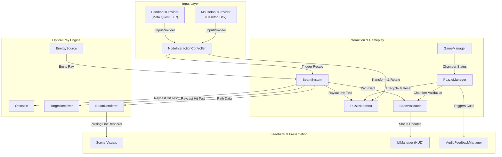

# LUMEN LOOM — Technical Architecture Specification

**Project:** LUMEN LOOM  
**Engine:** Unity 6 LTS (6000.0.32f1)  
**Render Pipeline:** Universal Render Pipeline (URP)  
**Target Architecture:** OpenXR / Meta Quest Standalone & PCVR  

---

## 1. System Overview

LUMEN LOOM is architected around the principle of strict separation between:
1. **Input Simulation & Spatial Tracking** (Mouse vs. VR Hand Tracking)
2. **Deterministic Optical Simulation** (Beam propagation, reflection, refraction, and loop checking)
3. **Gameplay Validation & Chamber State** (Target energization, move counts, and chamber reset)
4. **Visual & Auditory Feedback** (Line rendering, property block emission pulsing, and procedural synth audio)



---

## 2. Input Abstraction Architecture

To fulfill our core design constraint—**developing on an Intel Iris Xe laptop without a physical Quest headset while remaining 100% hand-tracking-ready**—we defined an abstract interface: `IInputProvider`.

### `IInputProvider` Contract
```csharp
public interface IInputProvider
{
    event Action<PuzzleNode> OnNodeSelected;
    event Action<Vector3> OnNodeDragPositionUpdated;
    event Action<float> OnNodeRotationDelta;
    event Action OnNodeReleased;
    event Action OnResetRequested;
    event Action OnDeselectRequested;

    bool IsDragging { get; }
    PuzzleNode HoveredNode { get; }
    PuzzleNode SelectedNode { get; }
}
```

### Concrete Providers:
- **`MouseInputProvider`:** Converts screen raycasts against the horizontal puzzle plane (`y = 0.5f`) into world positions, and maps Q/E keys and scroll wheel to rotation deltas.
- **`HandInputProvider`:** Receives raw hand tracking events from Meta Interaction SDK (`IInteractableView`, `HandGrabInteractable`) and routes them through the exact same delegates.

Because `NodeInteractionController` only consumes `IInputProvider`, switching between Desktop Mouse and VR Natural Hands requires zero code changes to the interaction logic.

---

## 3. Deterministic Beam Calculation Engine

The beam system (`BeamSystem.cs`) executes an optical ray-marching pass without physical rigidbodies or expensive physics calculations:

### Step-by-Step Raycast Algorithm:
1. **Emitter Ray Start:** Originates at `EnergySource.EmitterPosition` along `EnergySource.EmissionDirection`.
2. **Raycast Query:** A linear ray query `Physics.Raycast(...)` tests for collisions up to `maxBeamRange` (50m).
3. **Collision Classification:**
   - **`TargetReceiver`:** Tests reception alignment using dot product with target facing normal. If within acceptance cone (default: 90°), energizes the target and terminates ray.
   - **`PuzzleNode`:**
     - **Infinite Loop Check:** Evaluates whether `visitedNodeSet.Contains(node)`. If true, flags `HasLoopDetected = true` and halts, preventing infinite loop lockups.
     - Adds node to visited list and marks it as conducting light.
     - Computes the new output vector via `node.CalculateOutputDirection(...)`.
     - Recasts ray from node's output origin point.
   - **`Obstacle`:** Flashes obstacle material and halts ray.
   - **No Hit / Environment Wall:** Ray extends to max distance and terminates.
4. **Safety Counter:** Hard-limited by `maxReflections` (default: 10 bounces) to guarantee deterministic performance.

### Redirection Modes in `PuzzleNode.cs`
1. **`OrientationForward` (Collimated Optical Redirector):**  
   The node intercepts incoming light regardless of entrance vector and focuses it strictly out along its local forward vector (`transform.forward`).
   $$\vec{d}_{out} = \text{node.transform.forward}$$
2. **`MirrorReflection` (Planar Specular Reflector):**  
   Calculated according to the law of reflection:
   $$\vec{d}_{out} = \vec{d}_{in} - 2(\vec{d}_{in} \cdot \vec{n})\vec{n}$$
   where $\vec{n}$ is the mirror surface normal.

---

## 4. Puzzle Validation & Chamber Progression

The `BeamValidator.cs` and `PuzzleManager.cs` components manage game state progression:

- **Validation Rules:**
  - `path.HasReachedTarget == true`
  - `path.VisitedNodes.Count >= minNodesRequired` (ensures player doesn't bypass puzzle via direct line-of-sight if multiple steps are intended)
  - `path.HasLoopDetected == false`
- **Output States:**
  - `"TARGET CONNECTED"` (Solves chamber, triggers celestial audio chime, green emissive pulse)
  - `"ALIGN THE ENERGY NODES"` (Default unsolved state)
  - `"BEAM BLOCKED BY OBSTACLE"` (Informs player of path occlusion)
  - `"ENERGY LOOP DETECTED - REALIGN NODES"` (Warns player of circular resonance)

---

## 5. Mobile XR Optimization Strategy (Quest 3 / Iris Xe)

1. **Zero Per-Frame Allocations:** 
   - `List<Vector3>` point buffers in `BeamPath` are reused with `.Clear()` rather than instantiating new arrays each frame.
   - `MaterialPropertyBlock` instances are cached per node and target, eliminating material instantiation leaks.
2. **Forward Rendering Path:** Single-pass instanced rendering in URP eliminates deferred G-buffer memory bandwidth limits.
3. **Procedural Synth Audio:** Uses `AudioClip.Create(...)` to synthesize all UI and puzzle sound waveforms in memory at startup, avoiding asset loading latency and disk footprint.
4. **Batched Geometry:** Standard primitive meshes are used with lightweight shared shaders.
