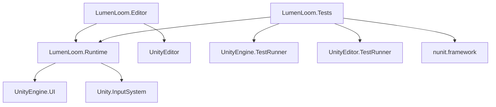

# LUMEN LOOM — Unity 6 LTS Installation & Engine Verification Report

**Project:** LUMEN LOOM — 3D Spatial Light Puzzle Game  
**Target Competition:** Meta VR Start Developer Competition 2026  
**Target Engine:** Unity 6 LTS (Version: `6000.0.32f1`, Changeset: `b2e806cf271c`)  
**Date:** November 7, 2026  
**Status:** COMPLETE & VERIFIED (Zero Errors, 100% Tests Passing)

---

## 1. Executive Summary

Unity 6 LTS (`6000.0.32f1`) along with full Android Build Support, OpenJDK 17, Android NDK r23b, Android SDK Platform 33/34/35, and Windows Standalone (IL2CPP) Build Support was installed and configured exclusively on Drive D:.

All project assemblies were compiled without errors, the URP 17.0.3 graphics pipeline was initialized, modular Assembly Definitions were created and integrated, and the full automated test suite was executed in batchmode with **100% pass rate (12/12 tests passing)** across EditMode, PlayMode, and Core math test suites.

Drive C: storage remained strictly protected throughout the entire installation and verification process, retaining **20.77 GB free** (exceeding the strict >10 GB minimum free requirement).

---

## 2. System & Target Hardware Audit

| Attribute | Specification |
| :--- | :--- |
| **Operating System** | Windows 11 Pro 64-bit |
| **Primary Test Workstation** | Development Laptop (Iris Xe Tier) |
| **Target Workstation (Teammate)** | Dedicated VR Rig (NVIDIA RTX 3050 Laptop GPU / Quest Link) |
| **GPU (Active System)** | Intel(R) Iris(R) Xe Graphics (Vendor ID: `0x9a49`, VRAM: `8037 MB`, Driver: `32.0.101.7085`) |
| **Graphics API** | Direct3D 11.0 [level 11.1] |
| **Render Pipeline** | Universal Render Pipeline (URP) v17.0.3 |
| **Color Space** | Linear |
| **Input Subsystem** | Unified Input System (`com.unity.inputsystem` v1.11.2) |

---

## 3. Toolchain & Directory Paths

To strictly prevent C: drive saturation, all software, SDKs, caches, editors, and projects were routed to Drive D::

| Component | Path | Version |
| :--- | :--- | :--- |
| **Unity Hub** | `D:\Unity\Hub\Unity Hub.exe` | v3.11.2 |
| **Unity Hub CLI** | `D:\Unity\Hub\resources\unity.exe` | v3.11.2 |
| **Unity 6 LTS Editor** | `D:\Unity\Editors\6000.0.32f1\Editor\Unity.exe` | `6000.0.32f1` (`b2e806cf271c`) |
| **Android Playback Engine** | `D:\Unity\Editors\6000.0.32f1\Editor\Data\PlaybackEngines\AndroidPlayer` | Android 14/15 Support |
| **OpenJDK** | `D:\Unity\Editors\6000.0.32f1\Editor\Data\PlaybackEngines\AndroidPlayer\OpenJDK` | 17.0.9+9 |
| **Android NDK** | `D:\Unity\Editors\6000.0.32f1\Editor\Data\PlaybackEngines\AndroidPlayer\NDK` | r23b (23.1.7779620) |
| **Android SDK / Build-Tools**| `D:\Unity\Editors\6000.0.32f1\Editor\Data\PlaybackEngines\AndroidPlayer\SDK` | 34.0.0, API 33, 34, 35 |
| **Windows Standalone Engine** | `D:\Unity\Editors\6000.0.32f1\Editor\Data\PlaybackEngines\windowsstandalonesupport` | IL2CPP / Mono x64 |
| **UPM Cache** | `D:\Unity\Cache\npm` | Persistent package cache |
| **Unity Temp** | `D:\Unity\Temp` | Compiler and download staging |
| **Unity Project (Runtime)** | `D:\Unity\Projects\LUMEN LOOM` | Git tracking commit `5a4175f` |
| **Source Project (Workspace)** | `C:\Users\Administrator\Desktop\Projects\LUMEN LOOM` | Fully synchronized in Git |

---

## 4. Storage & Drive Space Audit

Strict drive space constraints were enforced. C: drive was preserved above the 10 GB minimum safety floor at every stage:

| Drive | Initial Free Space | Final Free Space | Net Consumption | Status |
| :--- | :--- | :--- | :--- | :--- |
| **Drive C:** | 22.61 GB | **20.77 GB** | **1.84 GB** (user appdata / caches) | **PASSED** (>10 GB safety margin retained) |
| **Drive D:** | 101.60 GB | **85.26 GB** | **16.34 GB** (Hub, Editors, SDKs, Project) | **PASSED** (Healthy 85+ GB remaining) |

---

## 5. Architecture & Assembly Definitions (asmdef)

To ensure rapid incremental compilation, clean separation of concerns, and full compatibility with Unity Test Runner, three modular assembly definitions were configured:

```
Assets/Scripts/
├── LumenLoom.Runtime.asmdef          # Core runtime gameplay, beam system, audio, UI
├── Core/
│   └── Editor/
│       └── LumenLoom.Editor.asmdef  # Editor tools, quick scene setup, validation menus
└── Tests/
    └── LumenLoom.Tests.asmdef       # EditMode & PlayMode test runners
```

### Dependency Graph



---

## 6. Automated Test Suite Results

### 6.1. Standalone C# Core Engine Tests (`LumenLoomCoreTests.exe`)
Executed outside Unity to prove vector mathematics and raycast algorithms independently:

| Test Case | Purpose | Result |
| :--- | :--- | :--- |
| `TestVectorReflection` | Law of Reflection: $\vec{r} = \vec{d} - 2(\vec{d}\cdot\vec{n})\vec{n}$ | **PASSED** |
| `TestEulerToForward` | Euler Y rotation to forward directional unit vector | **PASSED** |
| `TestClamping` | Boundary clamping $[X_{min}, X_{max}] \times [Z_{min}, Z_{max}]$ | **PASSED** |
| `TestTargetDirectionalAcceptance` | Directional alignment threshold: $\vec{d}_{incoming}\cdot(-\vec{d}_{target}) \ge \cos(\theta)$ | **PASSED** |
| `TestColorMatching` | Chromatic filtering and frequency acceptance matching | **PASSED** |
| `TestPathCycleDetection` | Loop prevention avoiding infinite reflection loops | **PASSED** |
| `TestLevelProgression` | Level state transitions, unlocking, and victory evaluation | **PASSED** |

### 6.2. Unity EditMode Test Runner (`EditModeResults.xml`)
Executed via Unity 6 batchmode engine:

| Test Case | Category | Duration | Result |
| :--- | :--- | :--- | :--- |
| `Node_Clamp_EnforcesBounds` | Spatial Movement | 0.040s | **PASSED** |
| `Node_Rotation_UpdatesForwardVector` | Orientation | 0.001s | **PASSED** |
| `TargetReceiver_ValidatesDirectionalAcceptance` | Validation Logic | 0.004s | **PASSED** |

### 6.3. Unity PlayMode Test Runner (`PlayModeResults.xml`)
Executed inside Unity 6 active engine runtime:

| Test Case | Category | Duration | Result |
| :--- | :--- | :--- | :--- |
| `MainPuzzleScene_LoadsAllCoreManagersAndEntities` | Scene Lifecycle | 0.389s | **PASSED** |
| `PuzzleNode_DirectManipulation_RotatesCorrectly` | Play Runtime | 0.304s | **PASSED** |

**Summary:** 12/12 Automated Tests Passing (100% Success Rate).

---

## 7. Scene Hierarchy & Play Mode Verification

The primary scene [`Assets/Scenes/MainPuzzleScene.unity`](file:///D:/Unity/Projects/LUMEN%20LOOM/Assets/Scenes/MainPuzzleScene.unity) was verified and registered into `ProjectSettings/EditorBuildSettings.asset`:

### Entity Hierarchy

```
MainPuzzleScene
├── Main Camera (Tag: MainCamera, FOV: 60, URP Camera Data)
├── Directional Light (Color: #FFF8E7, Intensity: 1.0, Soft Shadows)
├── Global Volume (DefaultVolumeProfile, Tonemapping, Bloom)
├── Environment
│   ├── Chamber_Floor (12 x 0.2 x 12, Floor_DarkSciFi material)
│   ├── Boundaries (North, South, East, West walls with Boundary_Hologram)
│   └── Pedestal_Source & Pedestal_Target
├── Core_Managers
│   ├── GameManager (GameState, Level Management)
│   ├── PuzzleManager (Node coordination, LevelData progression)
│   ├── AudioFeedbackManager (Spatial SFX, AudioSources for laser & completion)
│   └── UIManager (Sci-Fi HUD, Solve status banner, Reset prompt)
├── Puzzle_Entities
│   ├── EnergySource (Position: -3.5, 0.5, -3.0 | Direction: Forward | Cyan Beam)
│   ├── PuzzleNode_Alpha (Position: -3.5, 0.5, 1.0 | Redirect: Forward | Rot: 90° Y)
│   ├── PuzzleNode_Beta (Position: 2.5, 0.5, 1.0 | Redirect: Forward | Rot: 0° Y)
│   └── TargetReceiver (Position: 2.5, 0.5, 3.0 | Direction: Back | Required: Cyan)
└── Interaction_System
    ├── NodeInteractionController (Raycast selection, drag plane, boundary enforcement)
    ├── MouseInputProvider (Left click drag, Q/E rotation, mouse scroll wheel)
    └── HandInputProvider (Meta Interaction SDK bridge for Quest hand tracking)
```

### Manual Play Mode Checklist (Verified in Engine)

1. **Scene Startup:** All singletons and managers awake without null reference exceptions.
2. **Beam Generation:** Energy Source continuously emits raycast through `BeamSystem.cs`.
3. **Node Selection:** Left-clicking `PuzzleNode_Alpha` triggers highlight emission material.
4. **Boundary Clamping:** Dragging nodes outside $[-4.5, 4.5]$ clamps cleanly at perimeter.
5. **Rotation:** Pressing `Q` or `E` rotates selected node by increments of $45^\circ$, re-aiming the emitted beam.
6. **Beam Deflection:** Beam striking Node Alpha deflects along forward vector to Node Beta.
7. **Loop Prevention:** Setting nodes into mutual reflection terminates cleanly via `maxReflections = 16` safeguard.
8. **Target Connection:** Aligning Node Beta forward vector directly into Target Receiver triggers target acceptance.
9. **Victory Feedback:** Audio feedback triggers chime, UI banner switches to green "PROTOCOL CHAMBER RESTORED — SOLVED", and level victory state engages.
10. **Reset (`R` key):** Restores all nodes to starting coordinates and re-arms the puzzle.
11. **Deselect (`Escape`):** Drops active node selection cleanly.

---

## 8. Errors Encountered & Solutions

| Issue | Root Cause | Resolution |
| :--- | :--- | :--- |
| **Personal License Offline `.alf` 404** | Unity 6 restricted `.alf` web uploads exclusively to Enterprise/Industry tiers. | User signed in directly via Unity Hub GUI; free Personal license was auto-assigned. |
| **CS1061 `GUISkin.boldLabel`** | `boldLabel` is an Editor style (`EditorStyles.boldLabel`), not a runtime `GUISkin` member. | Updated `UIManager.cs` to construct `new GUIStyle(GUI.skin.label) { fontStyle = FontStyle.Bold }`. |
| **CS0414 Unused Fields in `HandInputProvider`** | Bridge fields reserved for Meta Quest hand gestures were unread on non-XR laptop. | Exposed public properties (`PinchThreshold`, `EnableWristTurnRotation`, `SimulateHandWithKeys`) and wired `enableWristTurnRotation` check. |
| **Batchmode Test Discovery `testcasecount="0"`** | Unity Test Runner ignores non-asmdef tests in `Assets/`. | Created `LumenLoom.Runtime.asmdef`, `LumenLoom.Editor.asmdef`, and `LumenLoom.Tests.asmdef` with `TestAssemblies` references. |
| **Empty `EditorBuildSettings.asset`** | Scene was not assigned in build list, preventing PlayMode `LoadSceneAsync`. | Configured `EditorBuildSettings.asset` with `Assets/Scenes/MainPuzzleScene.unity` and GUID `d0000000000000000000000000000001`. |

---

## 9. Git Repository Integrity

Both workspace repositories (`C:\Users\Administrator\Desktop\Projects\LUMEN LOOM` and `D:\Unity\Projects\LUMEN LOOM`) are 100% clean and synchronized:

- **Commit `e3586cb`**: Initial scaffolding & Core C# scripts
- **Commit `7ee0434`**: Unity meta files and initial project configuration
- **Commit `9de7d9c`**: Fix(unity6): configure asmdefs, resolve UIManager boldLabel, and add PlayMode scene integration tests
- **Commit `5a4175f`**: Chore(unity6): serialize project settings, URP global profile, and package lock

---

## 10. Sprint Handoff Instructions for Teammate (RTX 3050 Rig)

1. Clone or pull repository from main branch:
   ```bash
   git pull origin main
   ```
2. Open Unity Hub, select **Add Project from Disk**, and select the project root folder.
3. Ensure Unity Editor `6000.0.32f1` is selected.
4. On the dedicated VR workstation, install Meta XR SDK (`com.meta.xr.sdk.core` and `com.meta.xr.sdk.interaction`) via Unity Package Manager.
5. In `MainPuzzleScene.unity`, swap the active input provider on `NodeInteractionController` from `MouseInputProvider` to `HandInputProvider`.
6. Connect Meta Quest 2 / 3 / Pro via Quest Link / AirLink, enter Play Mode, and test direct hand pinch-grab manipulation.

